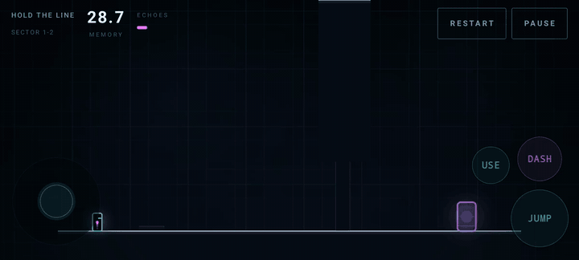

# Echo Runner: The World Remembers

A 2D puzzle-platformer for Android. You get 30 seconds per level. When the time is up,
everything you just did replays forever as a translucent **Echo**, and you get another 30
seconds alongside it. Puzzles are solved by choreographing several cooperating versions of
yourself.

30 levels across 7 chapters, plus Endless and Challenge modes.



*Level 1-2, take two. The cyan player stands at spawn while the magenta Echo — a recording of
what the player did during take one — walks the same path on its own, trailing particles. The
filled pip under ECHOES is the recorded timeline; MEMORY counts down the current take.*

## Build

```bash
./gradlew assembleDebug          # -> app/build/outputs/apk/debug/app-debug.apk
./gradlew testDebugUnitTest      # 11 tests
adb install -r app/build/outputs/apk/debug/app-debug.apk
```

Requires JDK 21 and the Android SDK (compileSdk 36, minSdk 26). `gradle.properties` pins
`org.gradle.java.home` because Gradle's default JVM may be a version AGP rejects; adjust that
line if your JDK lives elsewhere. Create `local.properties` with `sdk.dir=/path/to/android/sdk`.

## Two decisions that define the game

**Echoes replay recorded state, not recorded input.** Re-simulating input is smaller and sounds
more principled, but an Echo's path would then depend on the world it replays into — and since
Echoes open doors for each other, that world differs every take. Divergence would be the normal
case, making puzzles unsolvable by planning, which is the entire premise. So Echoes are fixed
kinematic ghosts: they never collide with geometry, but they retain full presence for plates,
switches, enemies and bullets.

**Echoes advance at the end of the tick.** `EchoManager.advance` increments its cursor then
reads position, so after k advances an Echo sits on recorded sample k, while the player finishes
tick i standing on what becomes sample i. Advancing mid-tick would evaluate every Echo one tick
(16.7 ms) ahead of the timeline that produced it — plates releasing a frame early, tight puzzles
quietly breaking. `GameEngine.simulate` documents the full tick order.

## Layout

```
core/      Frozen contracts: fixed 60 Hz timestep, y-down geometry, echo buffers,
           level schema, runtime world state, pooled bullets/particles
engine/    Swept-AABB physics, player controller, tick orchestrator
echo/      Recorder and kinematic replay lifecycle
entity/    Plates, switches, doors, movers, lasers, teleporters, turrets, walkers
level/     JSON parser and manifest-driven repository
render/    Neon Compose Canvas renderer + palette
audio/     Procedurally synthesised cues and ambient pad (no audio assets shipped)
save/      Atomic JSON progress store
mode/      Endless generator, Challenge definitions
ui/        Compose menus, HUD, touch controls, ViewModel
```

No game engine, no serialization library, no navigation library, no audio library. Only Kotlin,
AndroidX Compose, coroutines, and Android's bundled `org.json`.

Audio is synthesised at runtime because licensed audio can't be shipped and silent stubs would
make the game feel dead. `AudioController` is the seam — swapping in recorded audio touches only
`audio/`, never a call site.

## Adding a level

Two files, no code changes:

1. Write `app/src/main/assets/levels/<id>.json` — see `LEVEL_FORMAT.md` for the contract,
   coordinate system and jump budget.
2. Add the id to a chapter's `levels` array in `app/src/main/assets/levels/manifest.json`.

`LevelAssetTest` then validates it automatically: dangling signal references, ungrounded spawns,
floating exits, plates not flush with their surface, and doors gated on more plates than the
level's Echo budget can hold.

Every level's `hint` field holds a full take-by-take solution with distances and timings. That is
the solvability proof — a level without one is not finished. The in-game pause menu deliberately
shows only a one-line nudge instead, so the hints do not spoil the puzzles.

## World coordinates

40 × 22.5 units, **y-down**: y=0 is the top, gravity is +y, a jump is −y. A rect is anchored at
its top-left, so a platform's top surface is its `y` and a standing player's y is
`platformY − 1.55`. The player is 0.8 × 1.55, runs 9.2 u/s, jumps ~3.67 up, and a running jump
clears ~6.3 across. `core/GameConstants.kt` holds every tunable value.

## Tests

```
EchoLoopTest     replay stays frame-exact (drift < 0.001 units), an Echo genuinely holds a
                 plate, the puzzle is provably gated, simulation is deterministic, death
                 discards the take rather than banking a partial Echo
LevelAssetTest   all 30 levels parse and are structurally playable
```

## Known gaps

- Touch controls overlap the play field on tall screens; they should be anchored into the
  letterbox margin the renderer already leaves.
- Difficulty is validated structurally, not by playtesting.
